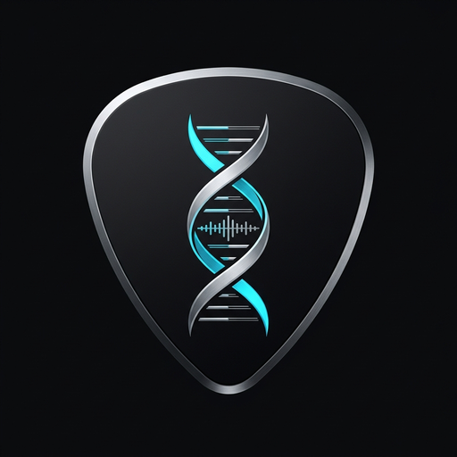
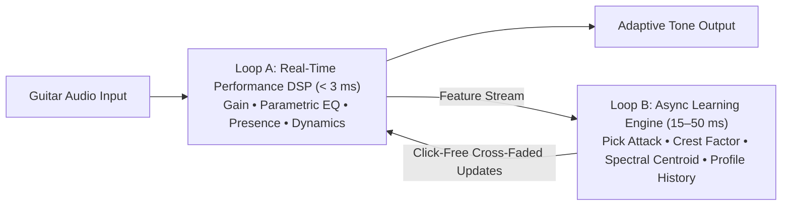

<p align="center">
  
</p>

# RIFFDNA™

> **Every player leaves a signature. RIFFDNA learns yours.**  
> *AI Performance-Adaptive Audio // Player-Adaptive Tone System*

**RIFFDNA™** (formerly *Adaptive Tone Engine*) is an AI-powered player-adaptive tone system that listens to how musicians perform and continuously adjusts tone characteristics in real time.

Most guitar rigs force musicians to adapt to presets.  
**RIFFDNA adapts to the musician.**

---

## Why RIFFDNA?

Traditional rigs require:
* Constant preset switching
* Manual EQ adjustments
* Compression tweaking & drive balancing
* Different setups for rhythm and lead

**RIFFDNA changes this.** By analysing playing style, picking dynamics, attack rise-time, note density, and articulation, RIFFDNA automatically adjusts tone parameters while you play.

**One player. One rig. Tone that evolves with the performance.**

---

## Watch (and Hear) The Tone Learn

Imagine moving naturally between:
* **Clean rhythm**
* **Blues lead**
* **Heavy palm-muted riffs**
* **Expressive solos**

Without touching a pedal. Without changing presets. Without opening a menu.  
RIFFDNA follows the player and reacts in real time.

> **Interactive Browser Rig:** Open [`docs/huggingface-space/index.html`](docs/huggingface-space/index.html) locally in any browser (or deploy it to a Hugging Face Static Space) to hear a live Web Audio A/B demonstration comparing a fixed preset against RIFFDNA adaptive DSP across Clean Rhythm, Heavy Palm-Mutes, and Lead Solo.

---

## Dual-Loop Architecture

Running heavy ML directly inside an audio callback causes buffer underruns, clicks, and unacceptable latency (`> 10 ms`). RIFFDNA separates real-time audio processing from continuous player analysis into two asynchronous loops:



* **Loop A — Performance Engine (`< 3 ms`):** Ultra-low latency DSP applying smooth, click-free parameter cross-fades.
* **Loop B — Learning Engine (`15–50 ms`):** Analyses player behaviour (`app/audio_analysis.py`, `app/learning_engine.py`, `app/cuda_audio.py`) and continuously refines tone targets and player signature profiles in SQLite.

---

## Key Features

### Player Recognition
RIFFDNA builds a live performance profile from your playing behaviour:
* Picking dynamics & attack rise-time
* Playing intensity & RMS crest factor
* Note density & sustain decay slope
* Spectral centroid (brightness) & articulation patterns

### Adaptive Tone Engine
Tone evolves automatically during performance:
* Dynamic gain & overdrive adjustment
* Adaptive mid-push & EQ shaping
* Presence control & compression balancing
* Hardware-accelerated CUDA / CPU fallback (`app/cuda_audio.py`)

### Signature Profiles & Live Performance Mode
Every musician develops a unique playing fingerprint. RIFFDNA stores evolving per-player profiles and feedback (`data/tone_engine.db`) designed for **Studio**, **Practice**, **Rehearsal**, and **Stage** workflows.

---

## Quick Start

```bash
git clone https://github.com/JupiterIsland/adaptive-tone-engine.git
cd adaptive-tone-engine
pip install -r requirements.txt
uvicorn backend.main:app --reload
```

---

## The Vision

Most music technology focuses on equipment—amp modelling, impulse responses, and static presets.  
**RIFFDNA focuses on the player.**

The goal is simple: create technology that responds to musicians as naturally as musicians respond to their instruments.

---

## Founder

Created by **Richard John Murray** (`JupiterIsland`).

RIFFDNA was built around a simple idea:

> *Your tone should follow your playing. Not the other way around.*

---

## License

Licensed under the MIT License.
