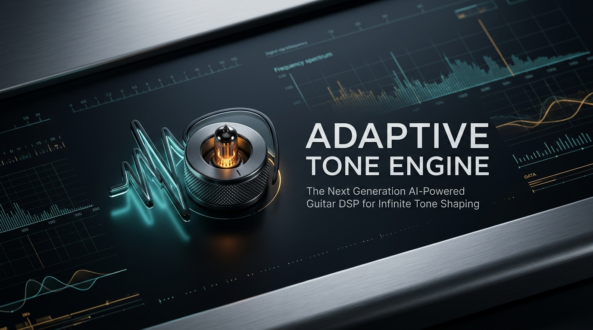

# Adaptive Tone Engine 🎛️⚡
### *Real-Time Dynamic Audio Intelligence for Guitarists and Producers*



**Adaptive Tone Engine** is an intelligent audio DSP & machine-learning layer that listens to how a musician plays in real-time—analyzing pick attack transients, playing dynamics, and harmonic brightness—and continuously sculpts amplifier and FX parameters to match the player's groove.

> **"Spend more time playing. Spend less time tweaking."**

---

## ⚡ The Core Problem & Dual-Loop Solution

Guitarists lose creative focus constantly reaching down to adjust overdrive knobs, presence dials, and compressor thresholds between rhythm chugging, expressive fingerpicking, and high-gain solos. 

Running traditional AI models directly on real-time audio leads to buffer underruns, clicks, and unacceptable latency (> 10ms). **Adaptive Tone Engine solves this with an asynchronous dual-loop architecture:**

```
[ Guitar Audio Input ] ────────► [ Loop A: Real-Time Audio DSP (< 3 ms) ] ────────► [ Output ]
                                            ▲                  │
                                        Parameter          Feature
                                         Updates            Stream
                                            │                  ▼
                                  [ Loop B: Async Feature Extraction (15–50 ms) ]
                                   • Pick attack transient velocity (Rise-time)
                                   • RMS energy & Crest factor (Dynamics)
                                   • Spectral centroid & Rolloff (Timbre)
                                   • Style Classifier & Tone Profile Map
```

* **Loop A (Hot DSP Path, < 3 ms latency):** Executes low-overhead parametric EQ, dynamic compression curves, and gain scaling in real-time. Parameter updates use smooth linear cross-fades to eliminate zipper noise.
* **Loop B (Async AI / Heuristic Analysis):** Inspects incoming audio frames, classifies performance intent (e.g. *heavy palm-mute* vs. *soft chord voicings* vs. *lead sustain*), and updates tone targets asynchronously.

---

## 🎯 Key Features

1. **Pick Attack Transient Gate:** Detects the instantaneous rise-time and hardness of the pick strike. Dynamically expands headroom or adds warm saturation on aggressive attacks while opening up presence on light touches.
2. **Spectral Timbre Tracking:** Computes rolling spectral centroid and rolloff frequencies to detect when single-note lead passages need a mid-frequency boost (800 Hz – 1.6 kHz) to cut through a band mix.
3. **Harmonic Crest Analysis:** Distinguishes complex multi-string open chords from monophonic melodies, backing off muddy reverb/delay reflections during rhythm playing and enriching sustain on solo notes.
4. **Hardware-Accelerated Fallback:** Built with multi-vendor support for **NVIDIA CUDA** (`cuSignal` FFTs), **AMD Zen AVX2 SIMD**, and standard cross-platform NumPy/SciPy backends.
5. **FastAPI Live Telemetry:** Stream live audio dynamics, detected attack strength, and active tone recommendations directly to any web browser or pedalboard display.

---

## 🚀 Quick Start

### 1. Requirements
* Python 3.10+
* Ubuntu / WSL2 or Windows 11
* Virtual environment recommended

### 2. Installation
```bash
git clone https://github.com/JupiterIsland/adaptive-tone-engine.git
cd adaptive-tone-engine
pip install -r requirements.txt
```

### 3. Launch the API & Analyzer
```bash
uvicorn app.main:app --host 0.0.0.0 --port 8000 --reload
```
Open **`http://localhost:8000/docs`** to explore the interactive API and upload WAV audio tracks for dynamic feature analysis.

---

## 🗺️ Roadmap

- [x] Initial FastAPI ingestion & transient detection scaffolding
- [x] Modern DSP Dual-Loop Architecture Specification & Studio Logo
- [ ] Real-time PortAudio / ASIO low-latency microphone & audio interface stream
- [ ] VST3 / CLAP / AU audio plugin wrapper (JUCE / C++)
- [ ] Standalone headless pedalboard image for Raspberry Pi 5 & embedded ARM
